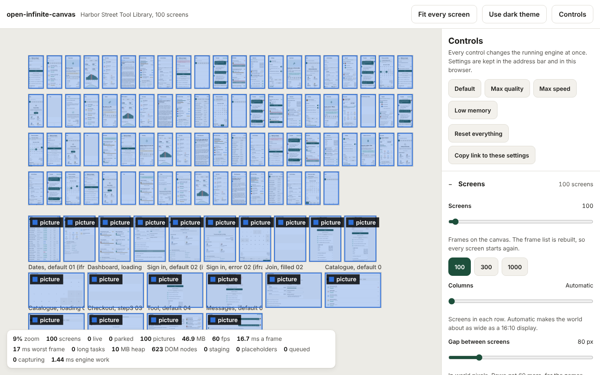
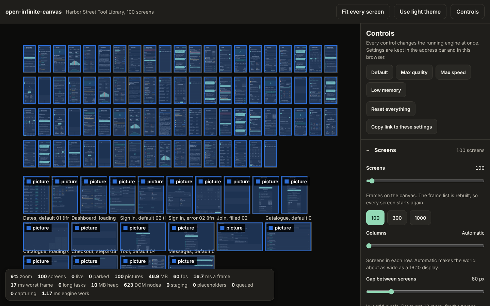

# The control panel

The demo has a control panel that changes the running engine. Use it to test the canvas on your own machine and to find the settings that suit it.





## Run it

```
pnpm install
pnpm demo
```

Open http://localhost:5311 and select **Controls** in the toolbar.

To try it from a phone or another computer on the same network, run `pnpm demo:host` and open the address Vite prints for your network.

## How it works

Every control maps to a real setting. Most are engine options, changed with `engine.reconfigure()`. The Screens group changes how the demo builds its frames. Nothing is mocked.

- Changes apply at once. The frame list is rebuilt a quarter of a second after the last change to the Screens group.
- Settings are saved in the address bar, after `#settings=`, and in this browser's local storage. The address bar wins. Only settings that differ from the defaults are saved, so a link stays short.
- **Copy link to these settings** copies an address that opens the demo with the same settings.
- **Reset everything** goes back to the defaults and clears what was saved.
- The older query parameters still work: `?n=`, `?isolated=`, `?maxLive=`, `?maxParked=`, `?theme=dark` and `?motion=reduce`. Add `?panel=open` to start with the panel open.

The panel works from the keyboard. Each group is a disclosure you open with Enter or Space. Every control is at least 44 pixels tall. It follows the demo's light and dark themes.

## Presets

| Preset | What it does |
|---|---|
| Default | The engine as it ships |
| Max quality | 48 live and 48 parked screens. Sharp pictures at full resolution, more of them kept. High smoothing. |
| Max speed | 8 live screens. Small pictures, low smoothing, a pixel ratio of 1 and one picture at a time. |
| Low memory | 8 live screens and none parked. Small caches and small pictures. A pixel ratio of 1. |

A preset changes the engine groups only. Screens and debug overlays stay as they are.

## The groups

### Screens

| Control | Range | Maps to |
|---|---|---|
| Screens | 50 to 2000, with buttons for 100, 300 and 1000 | `buildFrames(count)` |
| Columns | Automatic, or 1 to 60 | `buildFrames` `columns` |
| Gap between screens | 0 to 400 world pixels | `buildFrames` `gap`. Rows get 60 more for the names. |
| Screen size | Mixed, phones, tablets or desktops | `buildFrames` `device` |
| Screens in iframe mode | 0 to 40 | Sets `src` on that many frames. Desktop screens are picked first. |

A new frame list starts every screen again, and every picture is taken again.

### Camera

| Control | Maps to |
|---|---|
| Fit all | `engine.fit()` |
| Zoom to 100% | `engine.zoomAtPoint(1, ...)` about the centre |
| Reset camera | `engine.animateTo({ x: 0, y: 0, z: 1 })`, the world origin at 100% |
| Go to screen | `engine.select()` and `engine.fitFrame()` on the screen with that number |
| Smallest zoom, Largest zoom | `minZoom`, `maxZoom` |
| Zoom speed | `input.zoomSpeed` |
| Plain scroll | `input.wheel`. `pan` suits a trackpad. `zoom` suits a mouse wheel, and Shift with a scroll then pans. A pinch always zooms. |
| Glide after a drag | `input.inertia` |
| Glide friction | `input.friction`, the share of speed lost in each 60 Hz frame |

### Level of detail

| Control | Maps to |
|---|---|
| Live screens, at most | `lod.maxLive` |
| Parked screens, at most | `lod.maxParked` |
| Screens come alive from zoom | `lod.liveInScale` |
| Hysteresis | `lod.liveInScale` minus `lod.liveOutScale` |
| Smallest picture | `lod.tinyScale`. Drawn up to this zoom. |
| Middle picture | `lod.thumbScale`. Drawn up to this zoom, then the sharp one. |
| Middle pictures kept, Sharp pictures kept | `lod.maxThumbs`, `lod.maxPreviews` |
| Look ahead margin | `lod.marginPx`. Also the far canvas overscan. |
| Settle after | `lod.settleMs` |
| Mounts while still, Mounts while moving | `lod.mountsStill`, `lod.mountsMoving` |
| Skip mounts after a frame over | `lod.lateFrameMs` |
| Unmounts | `lod.evictionsPerFrame` |
| Staged at once, at most | `lod.stagingMax` |
| Staged in one frame | `lod.stagingPerFrame` |
| Pictures taken together | `lod.stagingGroup` |

### Pictures

| Control | Maps to |
|---|---|
| Provider | `provider`. Automatic, HTML in Canvas only, SVG only, or Screenshot files. |
| Smoothing when scaled | `pictureSmoothing`: automatic, high, low or off |
| Resolution of the sharp picture | `lod.previewScale`. The other two sizes are made from it. |
| Take pictures in the background | `warmup` |
| Pictures in progress, at most | `lod.captureConcurrency` |
| Files loading, at most | `lod.fileLoadsMax` |

HTML in Canvas only works in Chromium with its flag on. Elsewhere every picture fails and the frames stay placeholders. The panel counts the failures.

Screenshot files come from `pnpm demo:shots`. It builds the demo and saves one PNG for each screen template, device and theme into `apps/demo/public/shots`. It takes about a minute and uses the Chromium the benchmarks use. The files are not committed. Without them, every frame stays a placeholder.

### Rendering

| Control | Maps to |
|---|---|
| Far canvas | `farLayer`. Off hides the canvas and stops drawing it, so only live screens show. |
| Pixel ratio cap | `maxPixelRatio`. 0 is no cap. |
| Staging uses content-visibility | `contentVisibility`. Off hides staged screens with `visibility: hidden`, so they are laid out. |
| Reduced motion | `reducedMotion`: follow the system, on or off |
| will-change on the live layer | `willChange`: while moving, always or never |
| DOM origin | `origin`: follows the view, or fixed |
| Redraw the far canvas after a zoom of | `farZoomSlack` |

### Input

| Control | Maps to |
|---|---|
| Mouse button that pans anywhere | `input.panButton`: middle, right or none. The left button always pans on empty canvas. |
| Hold Space and drag to pan | `input.spaceDrag` |
| Arrow key step | `input.keyStep`. Shift moves four times as far. |

### Debug

| Control | What it shows |
|---|---|
| Colour every screen by tier | A tint and a label on every frame: green live, amber parked, purple staging, blue picture, grey placeholder |
| Outline mounted screens | A solid line round every screen that is real DOM |
| Hit test boxes | The box a click is tested against. The one under the pointer is red and named. |
| Spatial index cells | Every cell of the grid index that holds a frame |
| Full stats on the canvas | Frames a second, frame time, worst frame, long tasks, JS heap, DOM nodes, tier counts, the picture queue and engine work per frame |

The stats are sampled once a second. Long tasks and the JS heap are only reported by Chromium. Other browsers show n/a.

**Copy JSON** copies the settings, every engine option, the last stats, the last benchmark and the browser's details. Paste it into an issue or a note.

## Run benchmark

The benchmark runs in the page, about six seconds:

1. Fit every screen and wait for the view to settle.
2. Zoom into the centre, to 60%, over 1.5 seconds.
3. Pan three viewport widths sideways and back, over 3 seconds.
4. Zoom back out, over 1.5 seconds.

The camera moves once per animation frame. The panel then shows frames a second, the median, 95th percentile and worst frame time, frames over 50ms, long tasks, how many screens came alive and how many times the far canvas was drawn. Leave the mouse still while it runs.

## What has no control

- A placeholder zoom threshold. The engine has none. A frame is a placeholder only until its first picture.
- The glide time of `fit` and `animateTo`, fixed at 260ms.
- The cap on one scroll step, fixed at 50 pixels, so a mouse wheel notch does not jump.

## Tests

`bench/tests/controls.spec.ts` opens the panel, changes settings in every group, and checks that `engine.getOptions()` reports them. It also checks the wheel, the arrow key step, the overlay, the stats, the benchmark, saving and reloading, presets and Reset. It runs with `pnpm test:e2e`.

The pictures above come from the same file. To make them again, build with `pnpm test:e2e` once, then run `DOCS_IMAGES=1 pnpm --filter open-infinite-canvas-bench exec playwright test controls`.
